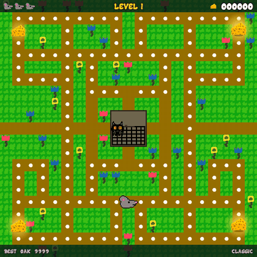

# Rat-Man

<p align="center">
  
</p>

<p align="center">
  <b>A Pac-Man-style maze game where you're the rat.</b><br>
  Collect the cheese, dodge the cats, grab the big cheese and turn the tables.<br>
  Every 4th level, the Three-Headed Cat comes for you.
</p>

<p align="center">
  <a href="https://damonsea.github.io/Rat-Man/"><b>▶ Play in your browser</b></a>
  &nbsp;·&nbsp;
  <a href="https://github.com/DamonSea/Rat-Man/releases/latest"><b>⬇ Mac &amp; Windows apps</b></a>
  &nbsp;·&nbsp;
  <a href="CHANGELOG.md">What's new</a>
</p>

## Play it (no Java needed)

**In your browser:** https://damonsea.github.io/Rat-Man/ — click **Play** (the first load takes a little while).
Controllers work there too: press any button on yours once the game has started.

Download the Mac or Windows app from the
[**Releases page**](https://github.com/DamonSea/Rat-Man/releases/latest), and see what changed
in each version in the [**changelog**](CHANGELOG.md). The first-launch
steps for unsigned apps are listed there.

## What's inside

<table>
  <tr>
    <td align="center" width="50%">
      <br>
      <b>Boss fights.</b> The Three-Headed Cat makes an entrance every 4th level.
    </td>
    <td align="center" width="50%">
      <br>
      <b>The Pounce.</b> Dodge its lunge and it slams into the wall, dizzy.
    </td>
  </tr>
  <tr>
    <td align="center">
      <br>
      <b>Take it down</b> and it goes out with a bang.
    </td>
    <td align="center">
      <br>
      <b>Skins,</b> including Joe Oakes, with a classic arcade spin-and-pop.
    </td>
  </tr>
  <tr>
    <td align="center">
      <br>
      <b>Controller support</b> for PS5, PS4, Xbox and Switch Pro, with rumble.
    </td>
    <td align="center">
      <br>
      <b>Arcade-style high scores</b>, so you can put your initials on the board.
    </td>
  </tr>
</table>

Meet the cats: **Alpha, the Chaser** comes straight for you, **Explorer, the Ambusher** cuts you off,
and **Yoda, the Flanker** comes at you from the side. **How to Play** on the main menu has the full rundown.

## Controls

| Action | Keyboard | Controller (PS5, PS4, Xbox, Switch Pro…) |
|---|---|---|
| Move | Arrow keys or WASD | D-pad or left stick |
| Menus | Mouse | D-pad to choose, Cross / A to select, Circle / B to go back |
| Pause menu | P or Esc (arrows + Enter to choose) | Options / Start (D-pad + Cross / A to choose) |
| Next level / restart | R or Enter | Cross / A |
| Enter initials | Type 3 letters, Enter to save, Esc to skip | Up/Down picks a letter, Cross / A confirms, Circle / B goes back |

Controllers work over USB or Bluetooth and can be connected any time. A PS5 controller's light bar
turns cheese-yellow, and controllers rumble when things happen (turn it off in **Settings**).

Debug mode (999 lives; press `0` to clear a level):
`mvn compile exec:java -Dratman.debug=true`

New to the game? **HOW TO PLAY** on the main menu explains the basics and introduces each cat.

## Levels

- Four hand-designed mazes: **Classic, Courtyard, Labyrinth, Boss Arena**. They repeat after level 4.
- Levels cycle through three themes: **Outdoor → Classroom → Planets**
- Levels 1–3 have 1–3 cats; level 4 is the **boss**, the Three-Headed Cat: fast, can't be eaten, and it
  **pounces** down corridors when it lines up with you (watch for the red lane). Then the cycle repeats.
- The cats hunt like Pac-Man's ghosts, each in its own way:
  - **Alpha, the Chaser (orange eyes):** the confident, reserved leader; follows the shortest path straight to you
  - **Explorer, the Ambusher (yellow eyes):** the smallest and scrappiest; aims 4 tiles ahead of where you're heading
  - **Yoda, the Flanker (green eyes):** the patient old soul; works with Alpha to box you in from the other side
- Cats alternate between short **scatter** waves (each runs to its own corner) and **chase** waves.
  They turn around when the wave changes. They start at half your speed and get faster each level (up to 80%).
- Prefer chaos? **Settings → Mazes: Random** generates a new maze every level (Settings also has Music and Sound FX toggles)

### Making your own level

Levels are plain text files in `src/main/resources/levels/` (`level1.txt` … `level4.txt`): 21 rows of
21 characters. `#` wall, `.` dot, `o` big cheese, `P` player start, `C` the cat cage (keep it as the 3×3
block in the exact centre), space = open floor with no dot. An open cell on the left/right edge is a
wrap-around tunnel. Any dot the player can't reach is removed automatically when the level loads.
- Skins: Rat, Squirrel, Joe Oakes

## Run it from source

Requires **Java 17+** and **Maven**.

```bash
mvn compile exec:java
```

Or open the folder in IntelliJ as a Maven project and run `ratman.RatMan`.

To build a jar: `mvn package` → `target/rat-man-1.1.0.jar`.

## Publishing a new version

1. Add a `## v1.3.0 — Short name (date)` section at the top of [`CHANGELOG.md`](CHANGELOG.md)
   listing what's new. GIFs go in `docs/media/`.
2. On GitHub, open the **Actions** tab → **Build apps** → **Run workflow**, type the same version
   (`1.3.0`), and click **Run workflow**.

A few minutes later the Mac and Windows apps appear on the Releases page, with that version's
changelog section as the "What's new" at the top. (Pushing a `v1.3.0` git tag does the same thing.)

The browser version (`web/index.html`, run by [CheerpJ](https://cheerpj.com/)) republishes itself through
`.github/workflows/pages.yml` whenever `main` changes.

The workflow is `.github/workflows/release.yml`; the download page text is `packaging/RELEASE_NOTES.md`;
the app icon comes from `packaging/make_icon.py`.

Changed the changelog or install guide after publishing? Run **Actions** → **Update release notes**
(leave the version empty to refresh every release page).

## Project layout

```
src/main/java/ratman/
  RatMan.java          entry point, window + screen switching
  GamePanel.java       game state, game loop, input
  Renderer.java        all drawing
  CatAI.java           cat chase, eaten-cat "eyes" pathfinding, boss
  Cat.java             one cat's state
  Maze.java            level loading + random maze generation
  Settings.java, SettingsMenu.java   saved settings (maze style, sound)
  Theme.java, Skin.java
  Leaderboard.java     high scores in leaderboard.txt
  SoundPlayer.java     music loops + sound effects
  Gamepad.java, PadMenu.java   controller support (Jamepad / SDL) and menu navigation
  Assets.java, UiStyle.java
  Menu.java, SkinsMenu.java
src/main/resources/    images, sounds, fonts, maze themes, levels/
tools/make_audio.py    chiptune synthesiser that generates all the game's audio
```

## Music and sound

All music and sound effects are original chiptune audio generated by `tools/make_audio.py`
(menu, level and boss themes, start / level-clear / game-over jingles, and effects). To change a tune,
edit its melody string in that script and run `python3 tools/make_audio.py` (needs numpy); it rewrites
the WAV files in `src/main/resources/sounds/`.

High scores are saved to `~/.ratman/leaderboard.txt` (your home folder), so playing doesn't create Git changes.
The first run copies in the team's original scores.
